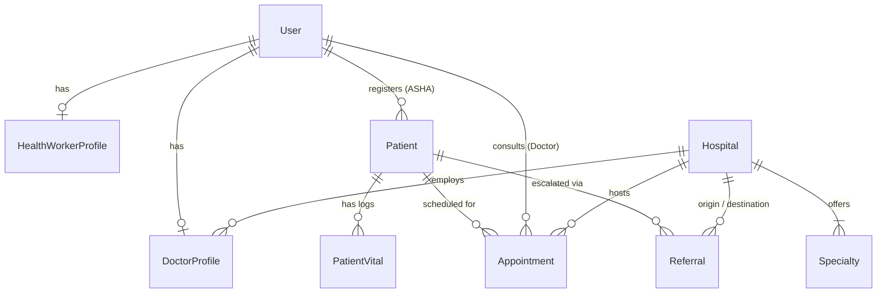

# SehatConnect — Rural Healthcare Access Platform (सेहत कनेक्ट)

> **Empowering Community Health Workers to bridge rural citizens and public healthcare infrastructure.**

---

## 🌟 Executive Overview
**SehatConnect** is a full-stack Django and modern responsive web application designed to solve the last-mile healthcare access crisis in rural India.

In rural communities, smartphone ownership and digital literacy are low, and distances to secondary and tertiary hospitals are substantial. Rather than burdening rural citizens with complex apps, **SehatConnect empowers frontline Community Health Workers (ASHAs and ANMs)** to act as the trusted digital bridge. Health workers register villagers, maintain digital health files, search nearby verified public hospitals (PHC, CHC, District Hospital), reserve time-slotted OPD appointments, generate printable token passes with QR codes, and coordinate Dial 108 emergency referrals.

---

## 🏗️ System Architecture & Technology Stack

```
                                +-----------------------------+
                                |      Web Client Browser     |
                                | Bootstrap 5, Leaflet, Chart |
                                +--------------+--------------+
                                               |
                                               | (HTTP / REST / HTML5)
                                               v
+------------------------------------------------------------------------------------------+
|                                     DJANGO BACKEND (MVT)                                 |
|                                                                                          |
|  +-------------------+  +-------------------+  +-------------------+  +---------------+  |
|  |     accounts      |  |     patients      |  |     hospitals     |  |  appointments |  |
|  | Role Auth, Custom |  | Patient Registry, |  | Facility Finder,  |  | Token Queue,  |  |
|  | User, ASHA/Doctor |  | Vitals, Consent   |  | OpenStreetMap GIS |  | Anti-Collision|  |
|  +-------------------+  +-------------------+  +-------------------+  +---------------+  |
|                                                                                          |
|  +-------------------+  +-------------------+  +-------------------+                     |
|  |     referrals     |  |     analytics     |  |       core        |                     |
|  | Inter-Facility    |  | Chart.js KPIs,    |  | Landing, Helplines|                     |
|  | 108 Ambulance Hub |  | Admin Controls    |  | Bilingual Context |                     |
|  +-------------------+  +-------------------+  +-------------------+                     |
+----------------------------------------------+-------------------------------------------+
                                               |
                                               | ORM
                                               v
                                +-----------------------------+
                                |      DATABASE LAYER         |
                                | SQLite (Dev) / PostgreSQL   |
                                +-----------------------------+
```

### Core Technologies
- **Backend:** Python 3.14+, Django 6.1 (Modular MVT Pattern)
- **Frontend:** Vanilla CSS design system, HTML5 Semantic, JavaScript ES6, Bootstrap 5.3
- **Mapping:** Leaflet.js + OpenStreetMap (Custom medical pins & popups)
- **Data Visualization:** Chart.js (Appointments line trend, referral donut, facility bar charts)
- **Slip Generation:** Python `qrcode` + Base64 PNG inline embedding
- **Authentication:** Django Authentication with custom user model & role decorators
- **Database:** SQLite (default for instant zero-dependency execution) / PostgreSQL support via `.env`

---

## 👥 3 Tailored User Roles (No Patient Accounts Required)

| Role | Target Persona | Primary Responsibilities |
|---|---|---|
| **1. Health Worker** | ASHA / ANM / MPW | Register patients in villages, record health vitals, search verified hospitals, book time-slotted OPD tokens, print passes with QR codes, initiate specialist referrals. |
| **2. Doctor / Staff** | Medical Officers & Specialists | Live daily OPD queue management, accept/reject requests, record clinical diagnosis & prescriptions, triage incoming emergency referrals, update bed vacancy. |
| **3. Administrator** | District Chief Medical Officer (CMO) | Verify healthcare facilities, oversee health workers and doctors, inspect live Chart.js metrics, audit district health coverage. |

---

## 🗄️ Database Schema & Models



### 1. `accounts.User`
- `role`: `health_worker`, `doctor`, `admin`
- `phone_number`: Mobile number
- `employee_id`: Government ID / ASHA badge number

### 2. `patients.Patient` & `PatientVital`
- `registration_id`: Unique identifier (e.g., `SC-PAT-XXXXXX`)
- `abha_id`: Optional 14-digit Ayushman Bharat Health Account
- `full_name`, `age`, `gender`, `guardian_name`, `phone`
- `village`, `panchayat`, `block`, `district`, `state`, `pincode`
- `blood_group`, `allergies`, `chronic_conditions`, `consent_given`
- `PatientVital`: Blood pressure (systolic/diastolic), pulse rate, SpO2 (%), body temperature, blood sugar, weight, height, BMI, notes.

### 3. `hospitals.Hospital` & `Specialty`
- `facility_type`: Sub-Centre, PHC, CHC, Sub-District Hospital, District Hospital, Medical College
- `latitude`, `longitude`: Exact GIS coordinates for OpenStreetMap
- `total_beds`, `available_beds`, `icu_beds`
- `ambulance_available`, `emergency_24x7`, `oxygen_plant_available`, `blood_bank_available`
- `is_verified`: Administrative verification status

### 4. `appointments.Appointment`
- `appointment_number`: Unique slip ID (e.g., `APT-20261102-XXXX`)
- `patient`, `doctor`, `hospital`, `appointment_date`, `time_slot`
- `token_number`: Auto-incrementing daily queue token for doctor
- `urgency`: Normal, Urgent, Emergency
- `status`: Pending, Confirmed, Completed, Cancelled, Rescheduled
- `doctor_notes`, `prescription`, `follow_up_date`
- **Anti-Collision Constraint:** Guaranteed prevention of double-booking for the same doctor, date, and time slot.

### 5. `referrals.Referral`
- `referral_code`: Unique code (e.g., `REF-XXXXXX`)
- `patient`, `from_hospital`, `to_hospital`, `target_specialty`
- `urgency`: Routine, Urgent, Emergency
- `transport_required`: Boolean (triggers Dial 108 Emergency Ambulance dispatch)
- `transport_status`: Not Needed, Requested, Dispatched, Arrived
- `status`: Pending Review, Accepted, In Transit, Attended, Completed, Rejected

---

## 📂 Project Directory Structure

```
SehatConnect/
├── manage.py
├── .env
├── .env.example
├── README.md
├── db.sqlite3
├── sehatconnect_project/
│   ├── settings.py
│   ├── urls.py
│   ├── wsgi.py
│   └── asgi.py
├── accounts/
│   ├── models.py
│   ├── views.py
│   ├── urls.py
│   ├── forms.py
│   ├── decorators.py
│   └── tests.py
├── patients/
│   ├── models.py
│   ├── views.py
│   ├── urls.py
│   ├── forms.py
│   └── tests.py
├── hospitals/
│   ├── models.py
│   ├── views.py
│   ├── urls.py
│   └── forms.py
├── appointments/
│   ├── models.py
│   ├── views.py
│   ├── urls.py
│   ├── forms.py
│   └── tests.py
├── referrals/
│   ├── models.py
│   ├── views.py
│   ├── urls.py
│   └── forms.py
├── analytics/
│   ├── views.py
│   └── urls.py
├── core/
│   ├── views.py
│   ├── urls.py
│   ├── translations.py
│   ├── context_processors.py
│   └── management/commands/seed_data.py
├── static/
│   ├── css/style.css
│   └── js/main.js
└── templates/
    ├── base.html
    ├── partials/
    │   └── sidebar.html
    ├── core/
    │   ├── home.html
    │   ├── about.html
    │   └── contact.html
    ├── accounts/
    │   ├── login.html
    │   ├── profile.html
    │   ├── worker_dashboard.html
    │   └── doctor_dashboard.html
    ├── patients/
    │   ├── patient_list.html
    │   ├── patient_detail.html
    │   ├── patient_form.html
    │   └── patient_confirm_delete.html
    ├── hospitals/
    │   ├── hospital_list.html
    │   ├── hospital_map.html
    │   ├── hospital_detail.html
    │   ├── hospital_form.html
    │   └── hospital_service_form.html
    ├── appointments/
    │   ├── appointment_list.html
    │   ├── appointment_form.html
    │   ├── appointment_detail.html
    │   ├── appointment_slip.html
    │   ├── appointment_consultation.html
    │   └── appointment_reschedule.html
    ├── referrals/
    │   ├── referral_list.html
    │   ├── referral_form.html
    │   └── referral_detail.html
    └── analytics/
        ├── admin_dashboard.html
        └── admin_users_list.html
```

---

## ⚡ Quickstart & Setup Guide

### 1. Prerequisites
- Python 3.10+ installed
- Pip package manager

### 2. Install Dependencies
```bash
pip install django pillow qrcode python-dotenv
```

### 3. Database Migrations
```bash
python manage.py makemigrations
python manage.py migrate
```

### 4. Seed Demo Healthcare Data
Populates public hospitals, specialist doctors, health workers, patients, appointments, and referrals:
```bash
python manage.py seed_data
```

### 5. Run Development Server
```bash
python manage.py runserver
```
Visit **`http://127.0.0.1:8000/`** in your browser.

---

## 🔑 Default Test Accounts

Use the **"Quick Demo Logins"** autofill buttons on the login page or enter these credentials:

| Role | Username | Password | Persona & Assignment |
|---|---|---|---|
| **Health Worker** | `asha_sunita` | `sunita123` | Sunita Sharma (ASHA Worker - Salamatpur Village, Sanchi Block) |
| **Health Worker** | `asha_anita` | `anita123` | Anita Bai (Senior ASHA - Kharwai Village, Raisen Block) |
| **Doctor** | `dr_sharma` | `sharma123` | Dr. Alok Sharma (MD Medicine - District Hospital Raisen, OPD Room 4) |
| **Doctor** | `dr_priya` | `priya123` | Dr. Priya Mehta (MS Gynaecology - District Hospital Raisen, MCH Ward) |
| **Administrator** | `admin` | `admin123` | Chief Medical Officer (CMO - District Health Administration) |

---

## 🧪 Automated Testing
Run the test suite verifying duplicate booking prevention, token generation, QR slips, and patient vitals:
```bash
python manage.py test
```

---

## 🌐 Multilingual English & Hindi Support
Switch seamlessly between English and Hindi at any time by clicking the language badge in the top navbar (`हिन्दी` / `English`). All navigation items, form labels, urgency levels, facility types, and instructions update instantly.

---

## 📄 Printable OPD Slip & Pass
Every appointment generates an official OPD slip containing:
- Direct **Token Number** (e.g. `TOKEN #1`)
- Scannable **QR Verification Code**
- Patient Demographic Card
- Consultant Doctor Name & Room Number
- Bilingual Patient Instructions in Hindi & English
- Print-ready stylesheet triggered via `window.print()` or the print button.
